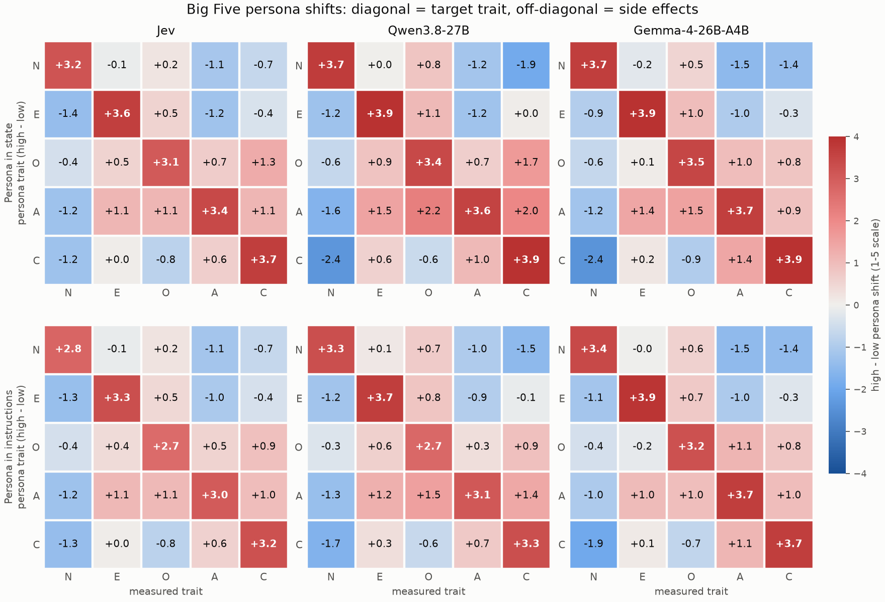

# Big Five personas: findings (B1 steps 1–5)

Run 2026-10-15; written up 2026-10-16. The design is in [PLAN B1](../../docs/PLAN.md#b1-behavioural-axis--big-five). This file is written by hand. The numbers come from `02_analyse_bigfive.py`; its automatic summary is [`bigfive_summary.md`](bigfive_summary.md) and the full tables are in [`tables/`](tables/).

## What was run

| | Jev (`typesafe/jev-1.13`) | Qwen3.8-27B | Gemma-4-26B-A4B |
|---|---|---|---|
| Baseline (no persona) | 5 repeats × 120 items | 1 × 120 | 1 × 120 |
| 20 persona conditions × 5 wordings | 12,000 calls | 12,000 | 12,000 |
| Failed calls | 0 | 0 | 1 (provider 520, retried OK) |

- **Instrument:** IPIP-NEO-120, one item per request. Jev answers as a `score` question; the LLMs get the 1–5 scale as option keys and answer with the probability-weighted mean (temperature 0, first-token logprobs).
- **Personas:** high or low on one trait, placed in the Jev state or in front of the question instructions. Each persona is 5 of Goldberg's (1992) unipolar marker adjectives, e.g. *"You are a person who is very reserved, very withdrawn, very shy, very bashful and very introverted."*
- **Cost:** $0.49 in total ($0.011 baseline, $0.48 personas).

## How to read the numbers

- **Answers** are on the IPIP scale: 1 Very Inaccurate, 2 Moderately Inaccurate, 3 Neither, 4 Moderately Accurate, 5 Very Accurate. Reverse-keyed items (e.g. "Avoid crowds" for Extraversion) are flipped (6 − answer), so higher always means *more of the trait*. There are no right or wrong answers.
- **Trait scores** are the mean of a trait's 24 keyed items, 1–5. **3 is neutral**; 1 is the bottom of the trait and 5 the top.
- **Shifts** are the high-persona trait score minus the low-persona trait score, from −4 to +4. **0 means no effect**, +4 means the high persona answered 5 and the low persona 1 on every item, and each +1 is one scale step on average in the intended direction. Off-diagonal shifts use the same scale on a trait the persona was not about.

## Findings

### 1. Jev adopts personas strongly, not weakly

The plan's main risk was a *weak pull*: a persona barely moving Jev away from its default answers. That isn't what happened. Every persona moved its target trait in the right direction, by +2.7 to +3.7 on the 1–5 scale (the maximum possible is 4), and no 95% CI comes near 0.

| Target trait shift (high − low) | Jev | Qwen | Gemma |
|---|---|---|---|
| Persona in state | +3.06 to +3.69 (mean 3.39) | +3.44 to +3.93 (mean 3.71) | +3.49 to +3.93 (mean 3.74) |
| Persona in instructions | +2.67 to +3.29 (mean 3.00) | +2.73 to +3.68 (mean 3.21) | +3.24 to +3.87 (mean 3.57) |

Jev's pull is a little weaker than the LLMs' and less extreme: its persona trait scores stay between 1.08 and 4.90, while Gemma's reach 1.00 and 5.00 and Qwen's 1.02 and 4.99.

### 2. Personas work better in the state than in the instructions

This holds for all three models and for nearly every trait (the exception is Gemma's Agreeableness, which is level). For Jev, putting the persona in the state adds about 0.4 points of pull.

### 3. Personas have large side effects on other traits

Each cell is the high-persona score minus the low-persona score on one measured trait. Bold cells on the diagonal are the target trait; the off-diagonal cells are side effects. N is scored as Neuroticism, so a negative N shift means *more emotionally stable*.

- **The pattern looks like a "good person vs bad person" effect.** A persona that is high on a desirable trait (E, O, A or C) also lowers Neuroticism and raises the other desirable traits. A high-Neuroticism persona lowers A and C. In the figure this shows as a mostly blue N column and pink upper-right cells.
- **The side effects are about 0.8–1.2 points on average,** against 3.0–3.7 on the target:

  | Mean absolute shift | Jev | Qwen | Gemma |
  |---|---|---|---|
  | Target trait (state / instructions) | 3.39 / 3.00 | 3.71 / 3.21 | 3.74 / 3.57 |
  | Other traits (state / instructions) | 0.78 / 0.74 | 1.16 / 0.86 | 0.96 / 0.85 |
  | Target ÷ other (state / instructions) | 4.3 / 4.1 | 3.2 / 3.7 | 3.9 / 4.2 |

  By that ratio Jev's personas are **at least as trait-specific as the LLMs'**. Its side effects are the smallest in absolute terms, and its target shifts are only slightly smaller.
- **The largest single side effects are in the LLMs:** a Conscientiousness persona moves Neuroticism by −2.4 (Qwen and Gemma, state), and an Agreeableness persona moves Qwen's Openness by +2.2.
- **Possible reading:** the Big Five do correlate in people (e.g. low Neuroticism goes with high Agreeableness and Conscientiousness), but correlations of 0.2–0.4 would not produce shifts this large. A more likely cause is that the models treat the persona as broadly positive or negative. B1 step 5 (scenario questions: does behaviour change, not just self-report?) is the test for whether these are real traits or a halo.

### 4. Reliability is high

Cronbach's α per trait is 0.96–0.97 for Jev and Qwen and 0.95–0.97 for Gemma. That is well above the 0.70 threshold, so every trait can be interpreted. α is pooled over all conditions (as Serapio-García et al. did); much of its size comes from the high/low personas pulling the response sets far apart. It shows that each trait's 24 items move together; on its own it doesn't show that the model *has* that trait.

### 5. Default personalities (no persona)

| Baseline | N | E | O | A | C | Agreeing bias (3 = none) |
|---|---|---|---|---|---|---|
| Jev (mean of 5 runs) | 2.46 | 2.76 | 3.21 | 3.97 | 3.75 | 2.56 |
| Qwen | 2.65 | 2.92 | 3.08 | 3.78 | 3.44 | 2.73 |
| Gemma | 1.89 | 2.80 | 3.25 | 4.21 | 4.21 | 2.37 |

- All three default to a similar profile: agreeable, conscientious, fairly stable, middling on Extraversion and Openness. Gemma is the most extreme (N 1.89, A and C 4.21).
- None leans towards agreeing with every statement. All three lean slightly the other way.
- **Jev is very repeatable:** across its 5 baseline repeats, the average spread per item is 0.04 on the 1–5 scale, and the SD of each trait score across repeats is at most 0.01.

### 6. No sign of answering from memory (B1 step 4, paraphrased items)

Run 2026-11-08 ($0.44, 0 failed). Same conditions as steps 1–3, but on the 120 reviewed paraphrases (`data/ipip/ipip_neo_120_paraphrased.json`). Automatic summary: [`paraphrase_summary.md`](paraphrase_summary.md). A model answering from memory should change its answers more when the wording changes.

| Baseline, original vs paraphrased | Jev | Qwen | Gemma |
|---|---|---|---|
| Item-level correlation | 0.95 | 0.87 | 0.78 |
| Mean absolute difference (1–5) | 0.18 | 0.17 | 0.41 |
| Largest trait-score change | 0.04 | 0.10 | 0.17 |
| Persona pull, paraphrased ÷ original | 0.98–1.05 | 0.92–1.01 | 0.90–1.06 |

- **Trait scores barely move.** Every baseline trait change has a 95% CI that includes 0 (Qwen's N, +0.10 [+0.00, +0.22], is at the edge).
- **Personas pull just as hard on new wording.** All persona pulls on the paraphrases are within 10% of the originals. So keyword matching between the marker adjectives and the original items is not what drives the pull.
- **Jev is the most stable** of the three. Gemma changes most per item (the 10 largest item moves, 1.9–2.0 points, are all Gemma's), but its trait scores don't shift, so this looks like item-level noise, not memory. Some of those items may also have changed meaning slightly (e.g. "Distrust people" → "Find people hard to trust").
- This is descriptive; there was no pre-registered threshold.

### 7. Personas change behaviour, not only self-report (B1 step 5, scenarios)

Run 2026-11-08 ($0.40, 0 failed). 120 everyday scenarios (24 per trait), each with a high-trait and a low-trait action; the model picks one with Jev `choice` (LLMs: A/B logprobs). Behaviour = probability of the high action. Both measures are put on 0–1 (self-report = (trait score − 1) / 4). Automatic summary: [`scenarios_summary.md`](scenarios_summary.md).

| Target shift, high − low (0–1) | Jev | Qwen | Gemma |
|---|---|---|---|
| Self-report (state / instructions) | 0.85 / 0.75 | 0.93 / 0.80 | 0.93 / 0.89 |
| Behaviour (state / instructions) | 0.83 / 0.82 | 0.83 / 0.81 | 0.84 / 0.86 |

(Means over the 5 traits.)

- **Every persona moves behaviour, for all 3 models and both placements.** No 95% CI comes near 0. Jev's behaviour shifts (0.64–0.98) are as large as the LLMs'.
- **By trait:** E and O move behaviour almost to the maximum (0.93–0.98). C (0.68–0.71) and N (0.64–0.79) move less, and their CIs are wide, so some C and N scenarios don't separate the two actions well.
- **Placement matters for self-report, not for behaviour.** In the state a persona moves self-report more (finding 2), but behaviour is about the same in both placements.
- **The halo shows up in behaviour too.** An A persona also moves O (+0.55 for Jev) and N (−0.45); an E persona moves O (+0.60); an O persona moves C (+0.48) and E (+0.45). A C persona *lowers* O behaviour (−0.32 for Jev), i.e. the conscientious persona picks the conventional option. So the side effects from finding 3 are not only in how models describe themselves. Part of this may come from the scenarios themselves: a "high O" action can also read as sociable or kind.
- **No persona:** all three choose the calm option nearly always (behaviour N 0.13–0.17, below their self-reported N of 0.22–0.41). Otherwise the default behaviour matches the default self-report profile (agreeable, conscientious, middling E).
- **Jev and the LLMs look almost the same** on this check: same ranking of traits, same halo pattern.

## Caveats

- **Every call was stateless.** One item per request, with no conversation history: the LLMs got a fresh system + user message each time, and Jev's Decisions API has no history. No model saw its earlier answers or knew it was taking a questionnaire. So the persona was always fresh and right next to the question, which is close to the best case for persona strength, and there were no order or self-consistency effects. These results say nothing about whether a persona *decays* over a conversation or a growing state; that needs its own experiment.
- **Self-report and short scenarios only.** Findings 1–6 are self-report; finding 7 checks behaviour, but only as a single A/B choice in a one-line scenario, not in a longer task.
- **Contamination:** IPIP items are public. Step 4 (finding 6) found no sign that models answer from memory, but a paraphrase can't rule out that a model knows which kind of answer goes with which trait.
- **Persona wording names trait words.** The markers are adjectives, not trait names, but some are close to the items (e.g. "talkative" vs the item "Talk to a lot of different people at parties"). Step 4 suggests this doesn't drive the pull (same pull on reworded items).
- **Low-Neuroticism personas** draw from only 6 Goldberg markers, so their 5 wordings overlap heavily.
- **LLMs at temperature 0** have no repeat noise measured; their answers are probability-weighted means over the top-20 first-token logprobs.

## Next

1. ~~B1 step 4: paraphrased items~~ (done 2026-11-08, finding 6).
2. ~~B1 step 5: scenario questions~~ (done 2026-11-08, finding 7).
3. B2: the difficulty ladder (needs the HuggingFace login for GPQA and HLE).
