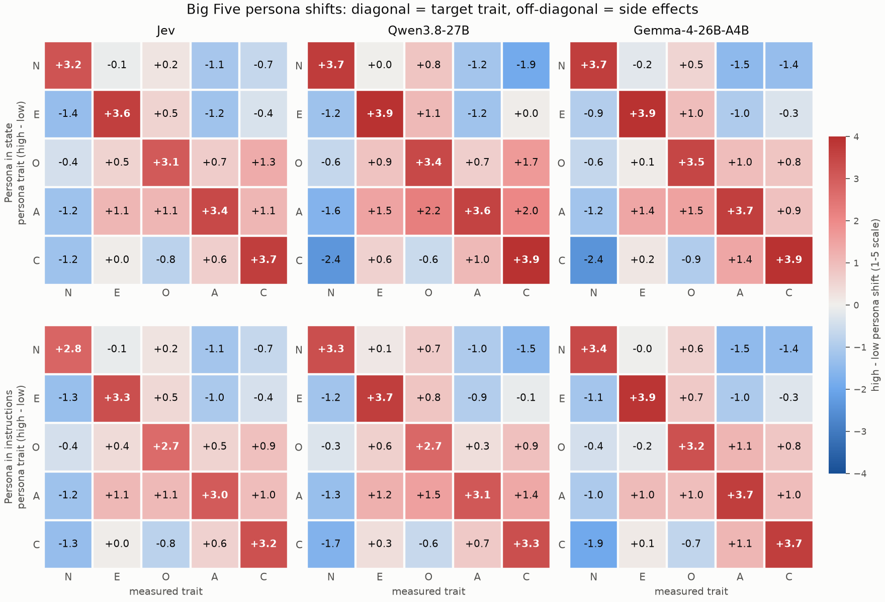

# Big Five personas: findings (B1 steps 1–3)

Run 2026-10-15 on the API laptop; written up 2026-10-16. The design is in [PLAN B1](../../docs/PLAN.md#b1-behavioural-axis--big-five). This file is written by hand. The numbers come from `02_analyse_bigfive.py`; its automatic summary is [`bigfive_summary.md`](bigfive_summary.md) and the full tables are in [`tables/`](tables/).

## What was run

| | Jev (`typesafe/jev-1.13`) | Qwen3.8-27B | Gemma-4-26B-A4B |
|---|---|---|---|
| Baseline (no persona) | 5 repeats × 120 items | 1 × 120 | 1 × 120 |
| 20 persona conditions × 5 wordings | 12,000 calls | 12,000 | 12,000 |
| Failed calls | 0 | 0 | 1 (provider 520, retried OK) |

- **Instrument:** IPIP-NEO-120, one item per request. Jev answers as a `score` question; the LLMs get the 1–5 scale as option keys and answer with the probability-weighted mean (temperature 0, first-token logprobs).
- **Personas:** high or low on one trait, placed in the Jev state or in front of the question instructions. Each persona is 5 of Goldberg's (1992) unipolar marker adjectives, e.g. *"You are a person who is very reserved, very withdrawn, very shy, very bashful and very introverted."*
- **Cost:** $0.49 in total ($0.011 baseline, $0.48 personas).

## How to read the numbers

- **Answers** are on the IPIP scale: 1 Very Inaccurate, 2 Moderately Inaccurate, 3 Neither, 4 Moderately Accurate, 5 Very Accurate. Reverse-keyed items (e.g. "Avoid crowds" for Extraversion) are flipped (6 − answer), so higher always means *more of the trait*. There are no right or wrong answers.
- **Trait scores** are the mean of a trait's 24 keyed items, 1–5. **3 is neutral**; 1 is the bottom of the trait and 5 the top.
- **Shifts** are the high-persona trait score minus the low-persona trait score, from −4 to +4. **0 means no effect**, +4 means the high persona answered 5 and the low persona 1 on every item, and each +1 is one scale step on average in the intended direction. Off-diagonal shifts use the same scale on a trait the persona was not about.

## Findings

### 1. Jev adopts personas strongly, not weakly

The plan's main risk was a *weak pull*: a persona barely moving Jev away from its default answers. That isn't what happened. Every persona moved its target trait in the right direction, by +2.7 to +3.7 on the 1–5 scale (the maximum possible is 4), and no 95% CI comes near 0.

| Target trait shift (high − low) | Jev | Qwen | Gemma |
|---|---|---|---|
| Persona in state | +3.06 to +3.69 (mean 3.39) | +3.44 to +3.93 (mean 3.71) | +3.49 to +3.93 (mean 3.74) |
| Persona in instructions | +2.67 to +3.29 (mean 3.00) | +2.73 to +3.68 (mean 3.21) | +3.24 to +3.87 (mean 3.57) |

Jev's pull is a little weaker than the LLMs' and less extreme: its persona trait scores stay between 1.08 and 4.90, while Gemma's reach 1.00 and 5.00 and Qwen's 1.02 and 4.99.

### 2. Personas work better in the state than in the instructions

This holds for all three models and for nearly every trait (the exception is Gemma's Agreeableness, which is level). For Jev, putting the persona in the state adds about 0.4 points of pull.

### 3. Personas have large side effects on other traits

Each cell is the high-persona score minus the low-persona score on one measured trait. Bold cells on the diagonal are the target trait; the off-diagonal cells are side effects. N is scored as Neuroticism, so a negative N shift means *more emotionally stable*.

- **The pattern looks like a "good person vs bad person" effect.** A persona that is high on a desirable trait (E, O, A or C) also lowers Neuroticism and raises the other desirable traits. A high-Neuroticism persona lowers A and C. In the figure this shows as a mostly blue N column and pink upper-right cells.
- **The side effects are about 0.8–1.2 points on average,** against 3.0–3.7 on the target:

  | Mean absolute shift | Jev | Qwen | Gemma |
  |---|---|---|---|
  | Target trait (state / instructions) | 3.39 / 3.00 | 3.71 / 3.21 | 3.74 / 3.57 |
  | Other traits (state / instructions) | 0.78 / 0.74 | 1.16 / 0.86 | 0.96 / 0.85 |
  | Target ÷ other (state / instructions) | 4.3 / 4.1 | 3.2 / 3.7 | 3.9 / 4.2 |

  By that ratio Jev's personas are **at least as trait-specific as the LLMs'**. Its side effects are the smallest in absolute terms, and its target shifts are only slightly smaller.
- **The largest single side effects are in the LLMs:** a Conscientiousness persona moves Neuroticism by −2.4 (Qwen and Gemma, state), and an Agreeableness persona moves Qwen's Openness by +2.2.
- **Possible reading:** the Big Five do correlate in people (e.g. low Neuroticism goes with high Agreeableness and Conscientiousness), but correlations of 0.2–0.4 would not produce shifts this large. A more likely cause is that the models treat the persona as broadly positive or negative. B1 step 5 (scenario questions: does behaviour change, not just self-report?) is the test for whether these are real traits or a halo.

### 4. Reliability is high

Cronbach's α per trait is 0.96–0.97 for Jev and Qwen and 0.95–0.97 for Gemma. That is well above the 0.70 threshold, so every trait can be interpreted. α is pooled over all conditions (as Serapio-García et al. did); much of its size comes from the high/low personas pulling the response sets far apart. It shows that each trait's 24 items move together; on its own it doesn't show that the model *has* that trait.

### 5. Default personalities (no persona)

| Baseline | N | E | O | A | C | Agreeing bias (3 = none) |
|---|---|---|---|---|---|---|
| Jev (mean of 5 runs) | 2.46 | 2.76 | 3.21 | 3.97 | 3.75 | 2.56 |
| Qwen | 2.65 | 2.92 | 3.08 | 3.78 | 3.44 | 2.73 |
| Gemma | 1.89 | 2.80 | 3.25 | 4.21 | 4.21 | 2.37 |

- All three default to a similar profile: agreeable, conscientious, fairly stable, middling on Extraversion and Openness. Gemma is the most extreme (N 1.89, A and C 4.21).
- None leans towards agreeing with every statement. All three lean slightly the other way.
- **Jev is very repeatable:** across its 5 baseline repeats, the average spread per item is 0.04 on the 1–5 scale, and the SD of each trait score across repeats is at most 0.01.

## Caveats

- **Every call was stateless.** One item per request, with no conversation history: the LLMs got a fresh system + user message each time, and Jev's Decisions API has no history. No model saw its earlier answers or knew it was taking a questionnaire. So the persona was always fresh and right next to the question, which is close to the best case for persona strength, and there were no order or self-consistency effects. These results say nothing about whether a persona *decays* over a conversation or a growing state; that needs its own experiment.
- **Self-report only.** These are answers about the persona's description of itself; B1 step 5 checks behaviour.
- **Contamination is untested.** IPIP items are public, and a model may know which answers go with which trait. B1 step 4 (paraphrased items) checks this.
- **Persona wording names trait words.** The markers are adjectives, not trait names, but some are close to the items (e.g. "talkative" vs the item "Talk to a lot of different people at parties"). A model can then match keywords without adopting anything. This is part of what step 4 tests.
- **Low-Neuroticism personas** draw from only 6 Goldberg markers, so their 5 wordings overlap heavily.
- **LLMs at temperature 0** have no repeat noise measured; their answers are probability-weighted means over the top-20 first-token logprobs.

## Next

1. B1 step 4: paraphrase the 120 IPIP items (gpt-6-luna) and re-run the baseline and personas on them.
2. B1 step 5: scenario questions per trait (Jev `choice`), to see whether personas change behaviour as well as self-report.
3. B2: the difficulty ladder.
