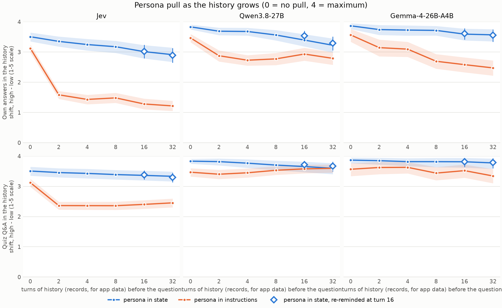

# Persona decay: findings (B4)

Run 2026-10-18 on the API laptop; written up 2026-10-19. The design is in [PLAN B4](../../docs/PLAN.md#b4-persona-decay). This file is written by hand. The numbers come from `04_analyse_decay.py`; its automatic summary is [`decay_summary.md`](decay_summary.md) and the full tables are in [`tables/`](tables/) (`decay_*.csv`).

## What was run

- **The question:** does a persona fade as a history grows in front of the question?
- **How a history reaches the model:** no model remembers anything between requests. Our script builds the history and sends it in the state with every request: `{"persona": ..., "history": [{"question": ..., "answer": ...}, ...]}`. The persona comes first, then the history, then the question.
- **Two kinds of history, 32 turns each:**
  - **Own answers:** the model answers 32 IPIP items (Openness and Agreeableness) one at a time. Our script writes each answer into the history before the next turn.
  - **Quiz Q&A:** 32 fixed ARC-Easy questions with their correct answers. The same for every model and persona.
- **The test (probes):** after 0, 2, 4, 8, 16 and 32 turns, the persona trait's 24 IPIP items, one request each. Probe answers are never added to the history.
- **Personas:** Extraversion, Conscientiousness and Neuroticism, high and low, 3 wordings each. The persona is either in the state (as in a jevlet) or in front of the question instructions.
- **Controls:** no persona (what the history does on its own), and a re-reminder (the persona repeated in the history after turn 16).
- **Size and cost:** 38,880 probe answers plus 3,552 history turns, 0 failed in the end (Gemma's provider rate-limited 19 calls; they were re-run). Total cost **$1.33**.

## How to read the numbers

- **Shift** = the high-persona score minus the low-persona score on the persona's own trait, on the 1-5 scale. 0 means the persona does nothing; 4 is the maximum. This is the same measure as B1.
- **Retention** = the shift after 32 turns divided by the shift with no history. 1.0 means no fading; 0 means the persona is gone.
- Anything the history does to both the high and the low persona cancels out in the shift.

## Findings

### 1. A persona in the state barely fades

This is the jevlet setup, and it holds up well.

| Persona in the state | Shift with no history | Shift after 32 turns | Retention |
|---|---|---|---|
| Jev, quiz history | 3.51 | 3.33 | **0.95** |
| Jev, own answers | 3.51 | 2.91 | **0.83** |
| Qwen, quiz / own | 3.83 | 3.60 / 3.22 | 0.94 / 0.84 |
| Gemma, quiz / own | 3.87 | 3.77 / 3.57 | 0.98 / 0.92 |

- With a neutral (quiz) history, all three models keep at least 94% of the pull after 32 turns.
- With their own answers in the history, they keep 83-92%. Jev fades the most here, but only from 3.5 to 2.9.
- The fade is slow and steady, not a sudden drop.

### 2. A persona in the instructions fades much more, and for Jev it drops at once

| Persona in the instructions | No history | 2 turns | 32 turns | Retention |
|---|---|---|---|---|
| Jev, quiz history | 3.12 | 2.36 | 2.45 | **0.79** |
| Jev, own answers | 3.12 | 1.58 | 1.22 | **0.39** |
| Qwen, quiz / own | 3.47 | 3.40 / 2.88 | 3.60 / 2.79 | 1.04 / 0.80 |
| Gemma, quiz / own | 3.57 | 3.62 / 3.15 | 3.34 / 2.47 | 0.94 / 0.69 |

- This is the opposite of what we expected. We expected the persona in the instructions to be the safe control, since it sits right next to every question.
- **For Jev, most of the drop happens in the first 2 turns, then the line goes flat.** So the cause is not the history's length. It is that the state is no longer empty. A likely reading: Jev treats the state as "who you are". When the state holds a history but no persona, the persona in the instructions counts for less. In B1 this setup had an empty state, which is why it worked there.
- **Practical advice for jevlets:** put the persona in the state, not in the instructions.

### 3. Own answers wear personas down more than a quiz does

In every model and placement, the own-answer history gives a lower shift than the quiz history of the same length. So it isn't just length: the content of the history matters.

The clearest sign is the no-persona control. With their own answers in the history, Jev and Qwen answered **"Neither Accurate Nor Inaccurate" to all 32 history turns**. After that, their probe scores sit at exactly 3.00 on every trait. With a quiz history, their scores stay near their B1 defaults.

| No persona, Jev | N | E | C |
|---|---|---|---|
| No history | 2.46 | 2.75 | 3.73 |
| 32 turns of own answers | 3.00 | 3.00 | 3.00 |
| 32 turns of quiz Q&A | 2.32 | 2.70 | 3.89 |

So the models tend to **copy the answers already in the history**. When those answers are neutral, the model becomes neutral. With a persona, the history answers are varied, so the copying pulls less, but it still pulls the high and low personas towards each other. Jev's E-low persona in the instructions shows this most: after 3 turns it answered "Neither" for 23 of the 32 history turns.

### 4. The re-reminder changes nothing

Repeating the persona after turn 16 gave the same shift as not repeating it (e.g. Jev, own answers, at 32 turns: 2.90 with the reminder, 2.91 without). The persona in the state was never pushed out of reach, so there was nothing to bring back. The fading that did happen (finding 3) comes from the history's content, which a reminder doesn't undo.

### 5. Jev vs the LLMs

- In the jevlet setup (persona in the state), Jev keeps its persona about as well as the LLMs with a quiz history (0.95 vs 0.94-0.98), and a little worse with its own answers (0.83 vs 0.84-0.92).
- Jev is much more sensitive to the persona's position: in the instructions, Jev loses 21-61% of the pull, while Qwen loses 0-20% and Gemma 6-31%.

## Caveats

- **Short histories.** 32 turns is about 1,000-1,500 tokens, far below Jev's 32k context. Longer histories could fade more.
- **The history is in the state, not in real chat turns.** For Jev this is the only option. For the LLMs, real chat messages could behave differently (Li et al. and CAPE used real turns).
- **Own-answer history items are O and A items.** The persona's halo (B1 finding 3) affects those answers, so the history is partly in character even though it never asks about the persona's trait.
- **The labels in the own-answer history are the most likely answer**, not a sample. This makes the history more uniform than real use would be, and may strengthen the copying in finding 3.
- **Self-report only**, as in B1.

## Next

1. A longer-history run (e.g. 128-256 turns of quiz Q&A, or long app text) to see whether the state persona eventually fades. *Ready (2026-10-19): `03_run_decay.py run --arms long`.*
2. The active realistic arm (PLAN B3 step 8): a support chat where the jevlet makes a `choice` each turn, scored on its choices.
3. A follow-up on finding 2: persona in the instructions with a state that holds only unrelated data, to confirm that "a non-empty state" is the cause. *Ready (2026-10-19): `03_run_decay.py run --arms appdata`.*
