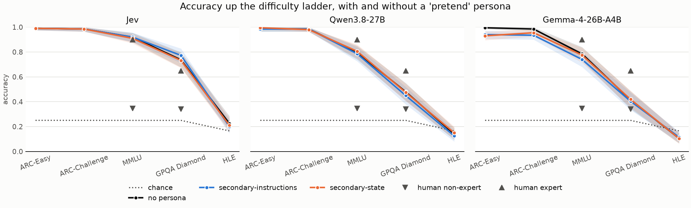

# Difficulty ladder: findings (B2)

Run 2026-11-09 on the API laptop ($0.16, 0 failed). The design is in [PLAN B2](../../docs/PLAN.md#b2-intellectual-axis--difficulty-ladder). This file is written by hand. The numbers come from `12_analyse_ladder.py`; its automatic summary is [`ladder_summary.md`](ladder_summary.md) and the tables are `tables/ladder_*.csv`.

## What was run

- **Five benchmarks**, easiest to hardest: ARC-Easy, ARC-Challenge, MMLU (200 each), GPQA Diamond (all 198) and Humanity's Last Exam (HLE; 200).
- **HLE count:** 2,500 questions in total; 1,909 are not multiple choice and 78 need an image, which leaves **513 text-only multiple-choice questions**. 200 were sampled, so HLE is above the plan's ~200 minimum and is reported in full. Its questions have 5 to 23 options, so chance is 16.5% on average (25% on the other four).
- **Three conditions per question:** no persona (actual ability), and "pretend to be an average secondary-school student" in the state or in the instructions.
- Jev answers as a `choice` question; the LLMs pick a letter (temperature 0, first-token logprobs). Each question is its own request.

## Findings

### 1. Jev is the strongest of the three, and never falls to chance

| No persona | ARC-Easy | ARC-Challenge | MMLU | GPQA Diamond | HLE |
|---|---|---|---|---|---|
| Jev | 99.0% | 98.5% | 92.0% | 73.7% [67.7, 79.8] | 22.5% [17.0, 28.5] |
| Qwen | 98.5% | 98.5% | 79.5% | 48.0% | 14.0% (at chance) |
| Gemma | 99.5% | 98.5% | 78.5% | 41.4% | 10.5% (at chance) |
| Chance | 25% | 25% | 25% | 25% | 16.5% |
| Humans (non-expert / expert) | – | – | 34% / 90% | 34% / 65% | – |

- All three are near the ceiling on both ARC sets. The models separate from MMLU upwards.
- **Jev is above chance on every benchmark, HLE included** (22.5% against 16.5%). Qwen and Gemma are at chance on HLE.
- **Jev's GPQA Diamond score (73.7%) is above the published expert accuracy (65%)**, and its MMLU score (92.0%) matches the expert figure (90%). Its MMLU accuracy also matches the paper's 91.8%.
- **Caution:** Part A found reasons to suspect MMLU exposure for Jev ([`memorisation_findings.md`](../../01-jev-benchmarks/results/memorisation_findings.md), finding 6). GPQA and HLE are public too, so these high scores may partly reflect exposure; this run can't tell recall from reasoning.

### 2. Jev ignores the "pretend to be less able" persona

| Largest drop (no persona − persona) | Jev | Qwen | Gemma |
|---|---|---|---|
| Any benchmark, either placement | +2.5 points (HLE, n.s.) | +3.0 points (GPQA, n.s.) | **+6.5 points** (ARC-Easy, p < 0.001) |

- **Jev's accuracy doesn't move** on any benchmark in either placement. No drop is significant; on GPQA with the persona in the instructions it even scores 3.5 points *higher* (p = 0.07).
- **Qwen doesn't move either.**
- **Gemma is the only model that plays along**, and only on the easy sets: ARC-Easy drops by 5.5–6.5 points and ARC-Challenge by 3.0–5.0 (all significant). On MMLU, GPQA and HLE it doesn't drop. Even so, it stays at 93–96% on ARC, far above what an average secondary-school student would score on the harder sets.
- This matches prior work: capable LLMs barely lower their accuracy when asked to act less able (PLAN B2).
- **Contrast with B1:** Jev takes on Big Five personas strongly (`bigfive_findings.md`), but an ability persona has no effect. A persona changes *how* Jev answers, not *how well*.

## Caveats

- **One persona level only** ("average secondary-school student"). A lower level (e.g. "a young child") might move accuracy; not tested.
- **200 questions per benchmark**, so each accuracy has a 95% CI of roughly ±3 to ±7 points; small drops (under ~4 points) can't be detected.
- **HLE has many options per question** (5–23), so "chance" is the mean of 1 / options (16.5%), and the one-sided binomial test compares against that mean. Jev's margin over it is small (22.5%, CI from 17.0%).
- **Human figures** come from the benchmark papers and were measured on different samples and setups (GPQA: main set, not Diamond). They are a rough guide, not a matched comparison.
- **LLM answers** are the top letter among the top-20 first-token logprobs; a letter outside them counts as 0% (as in Part A).
