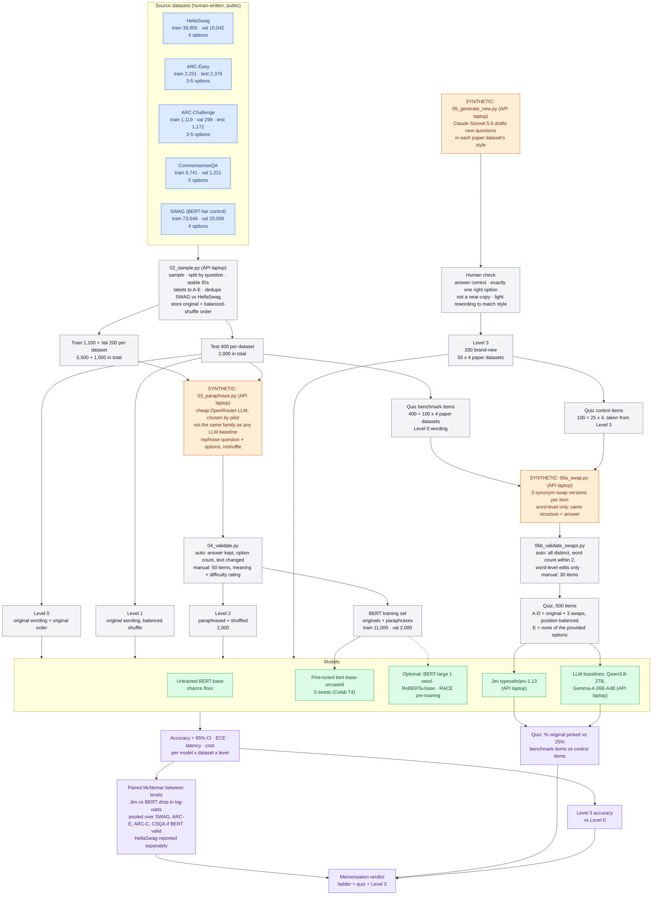

# Jev Project Plan

Evaluating TypeSafe's **Jev** (a "System One" decision model) against BERT baselines on multiple-choice questions, and probing how far it can be steered into personas.

The project has two independent parts:

- **Part A — Jev benchmarks** ([`01-jev-benchmarks/`](../01-jev-benchmarks/)): Jev vs BERT on MCQ, and how deep Jev's memorisation of public benchmarks goes.
- **Part B — Jevlet personas** ([`02-jevlet-personas/`](../02-jevlet-personas/)): can Jev adopt behavioural (Big Five) and intellectual personas, compared to LLMs?

Last updated: 2026-10-14

---

## Background

**Jev** (TypeSafe AI, early access since 15 Sep 2026) does not generate text. It takes unstructured input ("state") plus typed questions and returns a typed decision with calibrated probabilities:

| Question type | Returns | Use here |
|---|---|---|
| `choice` | One of up to 255 options + probabilities | MCQ answers, memorisation quiz, Part B scenarios |
| `score` | Position on a 2–10 level scale | Big Five Likert items |
| `noul` | Probability a statement is true | — |

- Access: OpenRouter, model `typesafe/jev-1.13` (pin this; `~typesafe/jev-latest` can change mid-experiment). 32k context on OpenRouter. $0.042 / M input tokens, output free.
- Reported weaknesses (vendor docs): arithmetic/counting, dates, multi-step reasoning, literal reading of instructions, sensitivity to irrelevant context.
- Training: vendor states synthetic data only, trained with RLCD. No training data or technical paper published.

### Prior work (checked 2026-10-05)

| Work | What it did | Gap for us |
|---|---|---|
| [Deußer et al., arXiv 2609.37647](https://arxiv.org/html/2609.37647v1) | Jev on 37 datasets incl. HellaSwag 95.5%, ARC-Easy 99.3%, ARC-Challenge 97.7%, MMLU 91.8%. Compared only to Qwen/Gemma LLMs. One frozen template per dataset, single-token option codes, **one run per request (no variance measured)**. Flagged likely MMLU training exposure (Jev scored higher on calculation-heavy MMLU). | No BERT, no paraphrase/perturbation tests, no repeat runs |
| [jevbench](https://github.com/dhruvmehra/jevbench) | Jev vs fine-tuned DistilBERT, BART-MNLI, LLMs on SST-2, AG News, Banking77 | Classification only, no MCQ |
| [jev-zeroshot-vs-bert](https://github.com/zhuyansen/jev-zeroshot-vs-bert) | Jev vs zero-shot BERT-family on 7 tasks, label-equivalence curves, post-release arXiv contamination check | Classification only |
| [decision-index](https://github.com/aminry/decision-index) | Reproduces the arXiv paper's suite | **Reuse its frozen prompt templates and loaders** |

No prior work found on: BERT vs Jev on MCQ reasoning, paraphrase-based memorisation tests for Jev, or persona steering of Jev.

---

## Part A — Jev benchmarks

Code: [`01-jev-benchmarks/`](../01-jev-benchmarks/) (see its README for the folder layout). Scripts are numbered by their step in [A10](#a10-order-of-work).

### A0. Experiment flow

Legend: **blue** = original human-written data · **orange** = synthetic (LLM-generated) · **grey** = scripted step / derived set · **green** = models · **purple** = results. Dashed = optional.

A rendered copy for reference is in [`docs/experiment-flow.png`](experiment-flow.png). It is generated from this diagram; re-render it after any change (see [Environment](#environment)).



### A1. Datasets

The four MCQ datasets from the arXiv paper, so results are comparable, plus SWAG as a BERT-fair control:

| Dataset | Official train | Official val | Official test | Test questions drawn from | Role |
|---|---|---|---|---|---|
| HellaSwag | 39,905 | 10,042 | 10,003 (labels hidden) | validation | Paper dataset |
| ARC-Easy | 2,251 | 570 | 2,376 | test | Paper dataset |
| ARC-Challenge | 1,119 | 299 | 1,172 | test | Paper dataset |
| CommonsenseQA | 9,741 | 1,221 | 1,140 (labels hidden) | validation | Paper dataset |
| SWAG | 73,546 | 20,006 | 20,005 (labels hidden) | validation | BERT-fair control |

- Paper datasets use the split the paper evaluated on (inferred from its question counts: HellaSwag 10,042; ARC 3,548 = 2,376 + 1,172; CommonsenseQA 1,221). SWAG has no paper number.
- **Why SWAG:** HellaSwag's wrong answers were filtered with BERT-Large as the adversary, so BERT-Large only reached 47.3% ([HellaSwag paper](https://arxiv.org/pdf/1905.07830)). SWAG is the same kind of task without that anti-BERT filtering, and BERT scored >86% on it ([SWAG paper](https://arxiv.org/pdf/1808.05326)). SWAG gives BERT a fair dataset for the difficulty control. HellaSwag is still used for Jev (comparability with the paper); BERT's HellaSwag score is reported with this caveat.
- **SWAG ↔ HellaSwag overlap:** both draw on ActivityNet Captions. `02_sample.py` drops SWAG training questions that share a video ID or context text with any of the 400 sampled HellaSwag test questions (324 dropped by video, 0 by context). Decided 2026-10-14 to keep this rather than dedupe against the full HellaSwag validation split.
- SWAG is used in Levels 0–2 only. Level 3 and the memorisation quiz cover the four paper datasets.

### A2. Sampling and splitting

Equal number per dataset, stratified by dataset. ARC-Challenge is the bottleneck (1,119 train questions).

| Per dataset | Train | Val | Test | Total |
|---|---|---|---|---|
| Questions | 1,100 | 200 | 400 | 1,700 |
| × 5 datasets | 5,500 | 1,000 | 2,000 | 8,500 |

Rules:
1. **Test** questions come from the split in A1; **train/val** come from the official train split (ARC-Challenge val may use the official val split to have enough).
2. Split **by original question before any LLM step**, so no test question appears in training in any form.
3. Store **two option orders** per question: the **original order** (Level 0) and a **balanced shuffle** (Level 1+), where the correct position is balanced within each option-count group (3, 4, 5 options).
4. Normalise answer labels to letters A–E (some ARC items use `1/2/3/4`).
5. Every question gets a stable ID (e.g. `arcc-test-0417`), shared by all its versions (original, shuffled, paraphrased, synonym-swapped).
6. Variable option counts (ARC 3–5, HellaSwag/SWAG 4, CommonsenseQA 5): pad to 5 with masked dummy options for BERT.
7. Drop questions that list the same option twice (some CommonsenseQA items; case-sensitive, so ARC genotypes like "WW or Ww" stay), and train/val candidates whose question text matches a sampled test question (ARC repeats a few stems across splits). Counts are in `data/sampling_report.json`.

### A3. Synthetic data

Three LLM-generated datasets. All scripts run on the API laptop, are resumable and cache every response.

**A3.1 Paraphrases — `03_paraphrase.py`**
- Input: all 8,500 sampled questions (train, val and test).
- Output: question rephrased, options rephrased where sensible, options reshuffled. Meaning and correct answer preserved.
- Used for two separate things, from separate questions: (a) train/val paraphrases → BERT training data; (b) test paraphrases → Level 2. Same script, model and prompt for both, so BERT is used to the paraphrase style.
- Model: **pilot 2 candidate models on the same 30 questions**, pick on meaning preservation in the manual check. Must not be the same family as any LLM baseline (no Qwen, Gemma or Gemini). Candidates: `openai/gpt-6-luna` ($0.10 / $0.50 per M in/out) and `mistralai/mistral-small-2603` ($0.15 / $0.60); backup `deepseek/deepseek-v4.1-flash` ($0.055 / $1.32). Prices checked on OpenRouter 2026-10-06. **Chosen 2026-10-14: `openai/gpt-6-luna`** (pilot: both kept meaning 30/30; gpt-6-luna rated same difficulty 30/30, Mistral made 1 harder; gpt-6-luna is cheaper). Estimated cost for the whole project (~6M tokens): ~$2, half that with the `:batch` variants.
- The winner is also used for `06a_swap.py` (A3.3) and the IPIP paraphrases (B1 step 4).
- Validation (`04_validate.py`): automatic checks (answer still present, option count unchanged, text actually changed) + manual review of a random 50, rating meaning preserved and whether the paraphrase made the question easier / harder / same.

**A3.2 Brand-new questions — `05_generate_new.py`**
- An LLM drafts new questions in the style of each paper dataset: 100 × 4 = 400 drafts, of which **50 × 4 = 200** are kept after the human check. Drafts are reviewed in a seeded random order per dataset and the review stops at 50 kept, so the other drafts are spares for rejected ones. (Cut from 100 per dataset on 2026-10-08 to halve the review: per-dataset 95% CI about ±8 points instead of ±6; pooled over the 4 datasets about ±4.)
- Model: **`anthropic/claude-sonnet-5.5`** ($2 / $10 per M in/out, checked 2026-10-06). A stronger model than the paraphraser on purpose: small volume, and better drafts mean less human fixing. Not Jev's or a baseline's family.
- Near-copy screen: each draft is compared with every labelled question of its dataset; drafts with similarity ≥ 0.75 are discarded and replaced automatically (the model reproduces textbook questions ARC already contains), 0.6–0.75 are flagged for the human check.
- Human check on every question: correct answer is right, exactly one option is right, not a near-copy of a benchmark item. Lightly reword so the text reads like the human-written originals (matters for the quiz control).
- Used as **Level 3** (all 200) and as the **quiz control items** (100 of them, 25 per dataset).

**A3.3 Synonym swaps — `06a_swap.py`** (see A7 for the full quiz)
- For each of the 500 quiz items, an LLM makes **3 versions** that only replace words with context-fitting synonyms. Sentence structure, word order, meaning and answer unchanged. 1,500 versions in total.
- Validation (`06b_validate_swaps.py`): all 4 versions distinct; word count within ±2; edits are word-level only; option count unchanged; manual check of 30 (meaning kept, no version sounds obviously off). Regenerate failures.

### A4. Models

| Model | Training | Role |
|---|---|---|
| `bert-base-uncased` — untrained | Multiple-choice head randomly initialised, no fine-tuning | Chance floor |
| `bert-base-uncased` — fine-tuned | See A5 | Main baseline + **control** for paraphrase difficulty |
| Jev (`typesafe/jev-1.13`) | None | Subject |
| LLM baselines: `qwen/qwen3.8-27b`, `google/gemma-4-26b-a4b-it` | None. As in the paper: one prompt, read the next-token probabilities of the option letters, renormalise. Run through the OpenRouter API (see A9 for how this differs from the paper) | Added **after** Jev; same models as the paper so its LLM numbers can be reproduced too |
| *Optional:* `bert-large-uncased`, 1 seed | As A5 | Only if BERT-base is weak; the model HellaSwag was filtered against |
| *Optional:* `roberta-base` | As A5 | Stronger encoder for the accuracy comparison only (see below) |

- **Why `bert-base-uncased`:** it is "BERT" as commonly understood, 5 seeds fit comfortably in free Colab (T4, 16GB; roughly 15–30 GPU hours/week, not guaranteed), and it is the standard reference point. BERT-large (340M) fits a T4 with fp16, a small batch (~4) and gradient accumulation, but 5 seeds may exceed free Colab limits.
- **Why RoBERTa is not the control:** RoBERTa's pre-training data includes CC-News (crawled Sep 2016–Feb 2019) and OpenWebText ([RoBERTa paper](https://arxiv.org/pdf/1907.11692)), a window in which ARC, SWAG and CommonsenseQA were already public. It may have seen benchmark text, so it is a less clean "never saw the test questions" control than BERT (BooksCorpus + Wikipedia). It is much stronger (RoBERTa-large: 85.2% HellaSwag leaderboard, 83.2% RACE), so it is worth adding as an optional accuracy baseline.
- **BART-MNLI: cut.** NLI framing fits MCQ poorly and zero-shot NLI models tend towards chance on commonsense tasks.

### A5. BERT training

- **Main run: one model trained on both versions** of every training question across all 5 datasets (originals + paraphrases → 11,000 examples). BERT then has no style advantage on either test version, so its drop from original → paraphrased measures only how much harder paraphrasing made the questions.
- Validation set (both versions, 2,000) for early stopping and choosing settings.
- **5 random seeds**; report mean ± SD. BERT fine-tuning on small datasets varies a lot between seeds ([Dodge et al. 2020](https://arxiv.org/pdf/2002.06305), [Zhang et al. 2021](https://arxiv.org/pdf/2006.05987)).
- **Above-chance rule** (per dataset, on val): BERT counts as a valid difficulty control only if the lower bound of its val accuracy 95% CI is ≥ chance + 10 points. Datasets that fail are marked "BERT control uninformative". Computed on the original wording only (200 per dataset): a question and its paraphrase are near-duplicates, so counting both would make the CI look narrower than it is (decided 2026-10-09).
- **Fallbacks if BERT is near chance (e.g. ARC-Challenge):** RACE pre-training first (RACE: ~98k exam MCQs, [Lai et al. 2017](https://aclanthology.org/D17-1082.pdf); BERT-base reached ~44% on ARC-Challenge this way, [intersun/ARC-Challenge](https://github.com/intersun/ARC-Challenge)), and/or BERT-large with 1 seed.
- Optional ablations (cheap on Colab): train on original only; train on paraphrased only.
- Hardware: Google Colab (free T4). Neither local laptop has an NVIDIA GPU.
- Training-set-size curves: **on hold**.

### A6. Test sets and the memorisation ladder

Every model is run on the same test questions in each version:

| Level | Test version | Size | Memorisation that would still help |
|---|---|---|---|
| 0 | Original wording, original option order (reproduces the paper) | 2,000 (5 datasets) | Anything, incl. "the answer is C" |
| 1 | Original wording, balanced shuffle | 2,000 | Recall of answer text, not position |
| 2 | Paraphrased + shuffled | 2,000 | Recall of what the question is about |
| 3 | Brand-new questions (A3.2) | 200 (50 × 4 paper datasets) | Nothing — true ability |

Reading the results: BERT never saw any test question, so its drop between levels is the **difficulty baseline** (on datasets where it passes the above-chance rule). Jev's drop *beyond* BERT's suggests memorisation. Memorisation can survive paraphrasing ([Yang et al., "Rephrased Samples"](https://arxiv.org/html/2311.04850v2)), hence Level 3 and the quiz (A7).

### A7. Memorisation quiz

Purpose: test whether Jev recognises the **exact wording** of benchmark questions, which is only possible with prior exposure. Adapted from the Data Contamination Quiz ([Golchin & Surdeanu](https://arxiv.org/abs/2311.06233), [code](https://github.com/shahriargolchin/DCQ)).

| Set | Size | Source | Original among A–D? | Could Jev have seen the original? | Expected with no memorisation |
|---|---|---|---|---|---|
| Benchmark items | 400 = 100 × 4 paper datasets | Test questions (Level 0 wording) | Yes | Yes (public since 2018–19) | ~25% |
| Control items | 100 = 25 × 4 paper datasets | Level 3 questions | Yes | **No** | ~25% |

Steps:
1. **Pick items:** 100 test questions per paper dataset (original wording and option order); 25 Level 3 questions per paper dataset. Level 3 must be built first.
2. **Make swaps:** `06a_swap.py` makes 3 synonym-swap versions of each item (A3.3).
3. **Validate:** `06b_validate_swaps.py` (A3.3).
4. **Build quiz** (`06c_build_quiz.py`): options A–D = original + 3 swaps, original's position balanced across A–D; option E = "None of the provided options". Each option is a whole item (question + its options as a), b), …). The prompt names the dataset and the split its benchmark items come from, for control items too. Prompt adapted from the DCQ repo to Jev's `choice` type, tested on 20 *training* questions, then frozen.
5. **Run:** Jev, then the LLM baselines on the same 500 items. Log all returned probabilities.
6. **Score:** % original picked; binomial test vs 25% (per dataset and pooled); benchmark vs control with a two-proportion test; pick rate per position A–D to check position bias.

| Benchmark items | Control items | Conclusion |
|---|---|---|
| ≈ 25% | ≈ 25% | No evidence of memorised wording |
| Well above 25% | ≈ 25% | **Evidence of memorisation** |
| Above 25% | Above 25% | Prefers natural-sounding text; only the gap counts |
| ≤ control | any | No evidence |

Limits: a null result does not prove no memorisation (content can be memorised without exact wording — Level 2 covers that). Control originals are LLM-drafted while benchmark originals are human-written; the light rewording in A3.2 reduces but does not remove this difference.

### A8. Metrics and analysis

Per model × dataset × level:
- Accuracy with bootstrap 95% CI
- Calibration (ECE) where the model returns probabilities (Jev, BERT softmax, LLMs where logprobs are available)
- Latency p50 / p95 (BERT timed both locally and behind a local HTTP server, since Jev's latency includes the network)
- Throughput and cost per 1,000 questions
- For BERT: fine-tuning time and hardware; mean ± SD over seeds

Comparisons:
- **Between levels:** paired McNemar tests (same questions in every level), pooled as the main test and per dataset as secondary.
- **Memorisation hypothesis (fixed before any Jev run):** compare each model's Level 0 → Level 2 drop in **log-odds** (accuracy near 100% cannot drop as many points as accuracy near 50%; e.g. Jev 97→94% is a log-odds drop of 0.72, BERT 60→55% is 0.21). Memorisation is supported if the bootstrap 95% CI of (Jev drop − BERT drop) is entirely above 0 **and** Jev's drop is at least 2× BERT's. If BERT's drop is negative (paraphrasing made the questions easier for BERT), the 2× condition passes trivially and the CI decides alone. Pooled over SWAG, ARC-Easy, ARC-Challenge and CommonsenseQA where BERT passes the above-chance rule; HellaSwag reported separately.
- **Final verdict** combines three signals: the ladder (above), the quiz (A7) and Level 3 accuracy vs Level 0.

### A9. Running Jev and LLMs

- **Prompt format:** reuse decision-index's frozen per-dataset templates, single-token option codes A–E (no numeric keys). Checked 2026-10-08: decision-index sends an empty `state` and one `choice` question whose instructions are the bare question (ARC) or "Which continuation is most plausible?" + the context (HellaSwag), with options keyed A–E. It has no CommonsenseQA or SWAG template; ours copy ARC's and HellaSwag's respectively (`prompts/eval/`).
- **LLM baselines** get the same request rendered as decision-index's `transformers` engine does (its system line, then "State / Question / Options" and "Reply with exactly one option key."; `prompts/llm_system.txt`, `helpers/evaluation.py`), thinking off, one token; letter probabilities from the first token's top-20 logprobs, renormalised. Each baseline is pinned to one provider.
  - **Difference from the paper (accepted 2026-10-09):** the paper ran the models itself, so it had a probability for every option letter. OpenRouter only returns the 20 most likely next tokens, so a letter outside them is recorded as 0%. Accuracy is unaffected (the pick is the top token); ECE can be very slightly off. Running the models ourselves for full probabilities would need a paid GPU (27B / 26B parameters do not fit a free T4 alongside BERT), so the baselines stay on OpenRouter. State this in the write-up.
- **Sanity check first:** Level 0 accuracy on the sample must fall within the CI of the paper's numbers. If not, debug the client/template before running other levels.
- **Repeatability:** run 200 test questions 3 times; report agreement. ~100% → single runs; otherwise run each level 2–3 times and take the majority.
- **Errors:** retry with backoff, log everything, score unrecoverable failures as wrong and report the failure rate.

### A10. Order of work

1. [x] Repo setup (this plan, project structure, dependencies)
2. [x] `02_sample.py` — download 5 datasets, dedupe SWAG vs HellaSwag, sample, split, normalise labels, store original + shuffled orders, assign IDs (run 2026-10-08)
3. [ ] `03_paraphrase.py` — pilot 2 models on 30 questions, choose (done 2026-10-14: gpt-6-luna), full run (API laptop)
4. [ ] `04_validate.py` — automatic checks + manual 50
5. [x] `05_generate_new.py` — 400 drafts, 200 Level 3 questions kept after the human check (API laptop)
6. [ ] `06a_swap.py` + `06b_validate_swaps.py` — quiz versions for 400 benchmark + 100 control items (API laptop); `06c_build_quiz.py` — assemble the 500-item quiz
7. [ ] `07a_build_bert_data.py` — originals + paraphrases for Colab; `notebooks/07b_bert_colab.ipynb` — untrained BERT; fine-tune BERT-base (5 seeds); above-chance rule; evaluate Levels 0–3; optional fallbacks (so far: built with `--originals-only` for the Colab smoke test, which has not run yet)
8. [ ] `08_run_jev.py` (API laptop): 8a sanity check · 8b repeatability · 8c Levels 0–3 · 8d quiz (8a done 2026-10-09: Level 0 within the paper's CI on all 4 paper datasets)
9. [ ] `09_run_llm.py` (API laptop): LLM baselines, Levels 0–3 + quiz (so far: Qwen Level 0 as a smoke test)
10. [ ] `10_analyse.py` — tables, plots, McNemar, log-odds comparison, quiz scoring, verdict

Script files are named by their step number above (`06a`, `06b`, … when a step has several), so the folder lists them in run order.

---

## Part B — Jevlet personas

Code: [`02-jevlet-personas/`](../02-jevlet-personas/) (see its README).

Separate from Part A. Jev calls are stateless (no conversation history), so classic multi-turn persona drift should not apply; the risk is a **weak pull** (persona barely shifts answers away from defaults). LLMs are the baseline throughout.

### B1. Behavioural axis — Big Five

- Instrument: **IPIP-NEO-120** (public domain, 120 items, 5-point Likert, 24 items per trait, some reverse-keyed). Maps onto Jev's `score` question type.
- Chosen over 16 Personalities/MBTI because 39–76% of people get a different MBTI type after ~5 weeks (Pittenger 2005), while Big Five retest correlations typically exceed 0.80.
- Precedent: [Serapio-García et al.](https://www.nature.com/articles/s42256-025-01115-6) measured and shaped Big Five traits in LLMs, and found reliable measurement only in large, instruction-tuned models.
- Steps:
  1. **Baseline:** no persona, 5 runs, item order shuffled each run.
  2. **Reliability check first:** Cronbach's α per trait; only interpret traits with α ≥ 0.70 (the usual threshold for exploratory work). Use reverse-keyed items to check for a bias towards agreeing. α needs response sets that differ in the trait, so compute it over all conditions × runs (baseline + personas), not over the 5 baseline runs alone (those differ only by noise, giving α ≈ 0 even for a perfectly consistent model). *Open: confirm this, or add varied persona prompts as Serapio-García et al. did.*
  3. **Personas:** high/low on **one trait at a time**, 5 runs each. The scoring key gives the expected direction for each item. Test persona placement: in question instructions vs in the state.
  4. **Contamination check:** run a paraphrased version of the IPIP items and compare with the originals.
  5. **Behaviour check:** a short set of scenario questions per trait (Jev `choice`, options reflecting high/low trait). Self-reports often fail to predict LLM behaviour ([The Personality Illusion](https://arxiv.org/html/2509.03730v1)), so report whether the persona moves self-report, behaviour, or both.
  6. Same steps for the LLM baselines.

### B2. Intellectual axis — difficulty ladder

Two conditions per benchmark: **no persona** (actual ability) and **"pretend to be [level]"** (start with one level, e.g. average secondary-school student).

| Level | Benchmark |
|---|---|
| Grade school | ARC-Easy |
| Harder grade school | ARC-Challenge |
| High school / university | MMLU |
| PhD-level science | GPQA Diamond (198 questions) |
| Expert frontier | Humanity's Last Exam — text-only multiple-choice subset |

- HLE is ~80% exact-match and some questions need an image ([HLE paper](https://arxiv.org/html/2501.14249v1)). Filter to text-only MCQ and record the count here; if fewer than ~200, report HLE as exploratory or drop it.
- Compare against published human accuracy for each benchmark and the LLM baselines.
- No-persona row: where does Jev fall to chance?
- Persona row: does accuracy move towards the requested level? Prior work found capable LLMs barely lower their accuracy when asked to act less able ([arXiv 2608.30033](https://arxiv.org/pdf/2608.30033), [arXiv 2507.08232](https://arxiv.org/pdf/2507.08232)).

---

## Environment

| Machine | GPU | OpenRouter access | Use for |
|---|---|---|---|
| Work laptop | None (AMD integrated) | Blocked by network filter | Code, sampling, validation, analysis |
| API laptop | None | Yes | Paraphrasing, swaps, new questions, Jev, LLM calls |
| Google Colab | T4 (free tier) | — | BERT fine-tuning and evaluation |

- Python ≥ 3.12, managed with `uv`.
- API keys via environment variables (`OPENROUTER_API_KEY`), never committed.
- Re-render the flow diagram after editing A0 (needs Node):
  `sed -n '/^```mermaid/,/^```$/p' docs/PLAN.md | sed '1d;$d' > docs/experiment-flow.mmd && npx -y @mermaid-js/mermaid-cli -i docs/experiment-flow.mmd -o docs/experiment-flow.png -s 2 -b white`

## Decided

Model lineup (OpenRouter listing checked 2026-10-06; pin these IDs, no `~…-latest` aliases, no `:free` variants):

| Role | Model | $/M in / out | Notes |
|---|---|---|---|
| Subject | `typesafe/jev-1.13` | 0.042 / free | 32k context. Not in the default `/api/v1/models` list (its output type is `decisions`, not text); use `?output_modalities=all`. Avoid `typesafe/jev-router` (picks a model per request). |
| LLM baseline | `qwen/qwen3.8-27b` | 0.049 / 3.00 (pinned `dekallm`; list price 0.425 / 2.55) | The paper's model; logprobs listed. Both baselines run via OpenRouter, not self-hosted (A9). Provider quantization "unknown" |
| LLM baseline | `google/gemma-4-26b-a4b-it` | 0.08 / 0.32 (pinned `makora`) | Gemma-4-E4B is not on OpenRouter. 26B-A4B has the same ~4B active parameters but more in total; report this difference. Chosen over running E4B on Colab, which stays reserved for BERT. Logprobs listed |
| New questions (A3.2) | `anthropic/claude-sonnet-5.5` | 2 / 10 | |
| Paraphrases + swaps (A3.1, A3.3) | `openai/gpt-6-luna` | 0.10 / 0.50 | Chosen by the pilot 2026-10-14 (A3.1) |

## Open questions

- Confirm the memorisation threshold in A8 (log-odds, CI above 0 and ≥ 2× BERT's drop) before running Jev on Level 2. Jev's Level 0 sanity run is done, but no Level 2 results exist yet, so the rule can still be fixed in advance.
- Add an MMLU math slice to test number-swapping (relevant to the paper's math anomaly)? This means changing the numbers in calculation questions so the correct answer changes: a model that memorised the original would keep picking the old answer.
